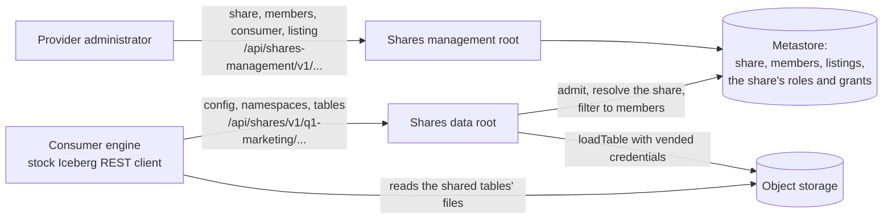
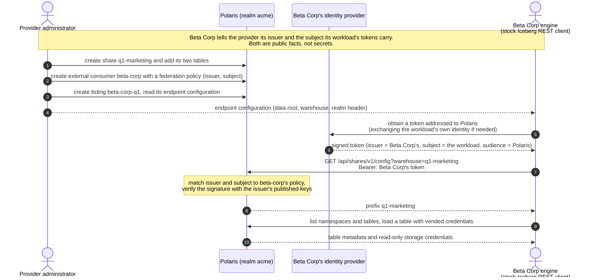

<!-- promoted: receipt pr-5d491573 · public-id shares-journeys · class state · revision 3 · supersedes receipt pr-cddc98d4 · exported 2026-10-23 · license Apache-2.0 · body-sha256 63286b6ec8840db0ae9bea7599d2c7f11bf4d463cabe44842c99e18911986b9c
     source: a private provenance chain (opaque; the mapping lives with the source). This document is maintained
     in place: every revision is a commit; earlier revisions stay in history, which is never rewritten. -->

# Polaris shares: end-to-end journeys

Companion to the Polaris shares design document, whose public revision follows its check against the implementation. The design holds the decisions and their reasons. This note shows them as calls: every provider and consumer request, with paths and example payloads.

Revised 2026-10-23 for the specification in apache/polaris#5446 (`info.version` 0.0.1). The specification has two files:
- the core API: shares and members;
- the optional consumer-management API: external consumers, listings, endpoint configuration and credentials.

How a consumer authenticates is left to the deployment.

Three things vary independently:
- **How the reader authenticates.** It can use its own identity provider, federated (proposed), a credential Polaris issues, or its standing as one of the provider's own principals. No path depends on this.
- **What admits the reader.** A listing, a static configuration, or, in the J7 alternative, the authorizer.
- **The paths.** J1 is the recommended combination and the one the specification takes; J2 to J6 record the alternatives.

The first three sections are J1 under each way of authenticating, federation first.

Running example: provider catalog `sales`; share `q1-marketing` with tables `marketing.campaigns` and `marketing.spend_by_region`; consumer `beta-corp`; listing `beta-corp-q1`; realm `acme`; host `polaris.example.com`.

The provider never calls the data root and the consumer never calls the management root. Both roots read the same metastore. The consumer's storage access is an ordinary vended credential, scoped to the shared tables.

## J1 with federation: the consumer's own identity provider (proposed)

**Proposed:** this is the external identity provider addendum. It is not in the specification at 0.0.1 and not built, and nothing in the specification precludes it. Field names are illustrative.

Beta Corp's workloads authenticate with Beta Corp's own identity provider: a corporate one, or the workload identity its cloud platform issues. The external consumer records which tokens are Beta Corp's, as a federation policy. Beta Corp's identity provider issues each token, addressed to Polaris; Polaris only validates it and mints nothing. Nobody creates, sends or stores a secret, and no Polaris principal stands behind the consumer.

| Step | Call | Result |
|---|---|---|
| P1 Enable | deployment configuration: `ENABLE_SHARES=true` | no API |
| P2 Create share | `POST /api/shares-management/v1/shares` | CreateShare. `catalogName` binds the one catalog; the share's principal role and its catalog role in `sales` are created here |
| P3 Add members | `POST /api/shares-management/v1/shares/q1-marketing/members` | UpdateShareMembers; returns the updated share. A member outside `sales`, or named twice in one batch, is `400` |
| P4 Create consumer | `POST /api/shares-management/v1/external-consumers` | CreateExternalConsumer with a federation policy. No principal is created |
| P6 Create listing | `POST /api/shares-management/v1/shares/q1-marketing/listings` | CreateListing. The listing record admits the consumer |
| P7 Read endpoint config | `GET /api/shares-management/v1/shares/q1-marketing/listings/beta-corp-q1/endpoint-config` | EndpointConfig: `catalogEndpoint = https://polaris.example.com/api/shares`, `warehouse = q1-marketing` |
| C1 Token | at Beta Corp's identity provider, addressed to Polaris | a token it signs. A workload that starts from another identity, such as its cloud platform's, exchanges it there. The provider never sees a Beta Corp secret, and Polaris issues no token |
| C1a Discover (optional) | `GET /api/shares/polaris/v1/catalogs` | `{ "catalogs": [ { "name": "q1-marketing" } ] }`: the shares the caller is admitted to. Tools use it; stock clients skip it |
| C2 Config | `GET /api/shares/v1/config?warehouse=q1-marketing` | ConfigResponse with `prefix = q1-marketing` |
| C3 List namespaces | `GET /api/shares/v1/q1-marketing/namespaces` | `{ "namespaces": [["marketing"]] }` |
| C4 List tables | `GET /api/shares/v1/q1-marketing/namespaces/marketing/tables` | the two members only |
| C5 Load table | `GET /api/shares/v1/q1-marketing/namespaces/marketing/tables/campaigns` with `X-Iceberg-Access-Delegation: vended-credentials` | LoadTableResult |
| C6 Refresh credentials | `GET …/tables/campaigns/credentials` | `{ "storage-credentials": [ … ] }` |
| C7 Write attempt | `POST /api/shares/v1/q1-marketing/namespaces/marketing/tables` | `404`: the route does not exist |
| C8 Non-member | `GET …/namespaces/marketing/tables/internal_costs` | `404 NoSuchTableException` |
| L1 Remove member | `POST …/shares/q1-marketing/members` with `"action": "REMOVE"` | the member leaves every reader's view |
| L2 Delete listing | `DELETE …/shares/q1-marketing/listings/beta-corp-q1` | `204`; Beta Corp's next call fails |
| L3 Keys | none | Beta Corp rotates its own signing keys; Polaris follows the issuer's published keys |
| L4 Delete consumer | `DELETE /api/shares-management/v1/external-consumers/beta-corp` | `204`; its listings and its policy go with it |
| L5 Delete share | `DELETE /api/shares-management/v1/shares/q1-marketing` | `204`; every listing is revoked and the share's roles are dropped |

The roots read as siblings: `/api/shares-management/v1/…` beside `/api/management/v1/…` for the provider, and `/api/shares/v1/…` beside `/api/catalog/v1/…` for the consumer.

Every call carries Beta Corp's token, and Polaris validates it each time: the issuer's published keys, then the consumer's policy. A stock client needs only to send a bearer token it obtains itself, through a static token property or a pluggable authentication manager that refreshes it. Deleting the listing or the consumer takes effect on the next call. A variant the addendum may weigh is to exchange the token once at Polaris's token endpoint, as cloud token services do. Polaris would then issue short-lived tokens of its own, though never secrets.

What Polaris would need:
- **Trust per consumer.** Polaris validates tokens from each issuer an external consumer names, with that issuer's published keys. Realm-level authentication today trusts only the issuers the deployment configures.
- **Resolution.** A token's issuer and subject resolve to exactly one external consumer.
- **Admission without a principal.** The listing record is the evidence. Every admitted request is already served by a principal built for that request alone, holding only the share's role, so the consumer needs no principal of its own.
- **In the specification:** an optional federation policy on the external consumer. That is an additive change to the optional file.

## J1 with a credential Polaris issues

A consumer with no identity provider to federate gets a client credential from Polaris, through the optional file's credential operations. This is built today. Only these rows differ from the federated journey:

| Step | Call | Result |
|---|---|---|
| P4 Create consumer | `POST /api/shares-management/v1/external-consumers` | CreateExternalConsumer, without a federation policy. A hidden principal is created with it |
| P5 Issue credential | `POST /api/shares-management/v1/external-consumers/beta-corp/credentials` | CreateConsumerCredential: the client id, the secret (this once), `oauth2ServerUri = https://polaris.example.com/api/shares/v1/oauth/tokens` and the scope |
| P6 Create listing | as above | also grants the consumer's principal usage of the share's principal role |
| C1 Token | `POST https://polaris.example.com/api/shares/v1/oauth/tokens` | client-credentials token request |
| L3 Rotate credential | `POST …/external-consumers/beta-corp/credentials/c1/rotate` | a new pair; the old one stays valid for a service-defined overlap |
| L4 Delete consumer | as above | its credential goes with it |

The provider sends the secret over a channel the two parties trust. On a realm that authenticates only through an identity provider, Polaris issues no credential: create and rotate answer `409` before any secret exists. The in-server token endpoint is deprecated upstream only as a requirement on every catalog, not for a provider issuing its own tokens.

## J1 without consumer management: static admission

The deployment serves only the core API and admits readers from a static configuration. The reader is an ordinary Polaris principal, `beta-reader`, which the provider creates and grants as usual. There is no external consumer, credential, listing or endpoint configuration.

| Step | Call | Result |
|---|---|---|
| P1 Enable | deployment configuration: `ENABLE_SHARES=true`, `polaris.shares.consumer-management.enabled=false`, `polaris.shares.admission.type=static` | no API |
| P1a Admission rule | a JSON file naming, for realm `acme` and share `q1-marketing`, the principal `beta-reader` or a principal role it holds: `{"realms": {"acme": {"shares": {"q1-marketing": {"principals": ["beta-reader"]}}}}}` | read at startup; a missing or malformed file stops the server |
| P2, P3 | as in the federated journey | |
| P4 to P7 | not served | the consumer-management routes answer `404` |
| C1 Token | the principal's ordinary token | from Polaris (`/api/catalog/v1/oauth/tokens`), or from the provider's own identity provider |
| C2 to C8 | as in the federated journey | the same data root, prefix, member filtering and read-only vending |
| L2 Revoke | remove the rule and restart, or revoke the matched principal role | `404` from the next request; a role revocation takes effect at once |

Each admitted request runs as a request-local principal that holds only the share's principal role. So `beta-reader` holds nothing of the share's on any other request, and its access on `/api/catalog` is exactly what its own grants allow. Events name `beta-reader` and the rule that admitted it.

**Single sign-on.** On a realm that authenticates through the provider's own identity provider (`polaris.authentication.type=external` or `mixed`), Polaris maps each token to a stored principal by a claim, and static admission admits it like any other principal. That is single sign-on for the provider's own principals, not federation with a consumer's identity provider.

## How each reader is admitted

| The reader authenticates with | Admitted through | Polaris principal | Status |
|---|---|---|---|
| its own identity provider, federated | a listing | none | proposed |
| a credential Polaris issues | a listing | the consumer's hidden principal | built |
| the provider's own identity provider or Polaris credentials, as a stored principal | static admission | the stored principal | built |
| an identity provider alone, with no principal stored | the authorizer (J7) | none | proposed |

## Payloads

- **CreateShare:** `{ "share": { "name": "q1-marketing", "catalogName": "sales", "description": "FY26 Q1 marketing aggregates" } }`.
- **UpdateShareMembers:** `{ "currentEntityVersion": 1, "updates": [ { "action": "ADD", "member": { "type": "TABLE", "canonical": { "namespace": ["marketing"], "name": "campaigns" } } }, … ] }`, with `spend_by_region` likewise. Returns `200` with the updated share and its new `entityVersion`.
- **CreateExternalConsumer:** `{ "externalConsumer": { "name": "beta-corp", "description": "Beta Corp analytics" } }`. Federated (proposed), it adds `"federation": { "issuer": "https://login.beta-corp.example", "subjectClaim": "sub", "subject": "q1-reader", "audience": "https://polaris.example.com/api/shares" }`.
- **CreateListing:** `{ "name": "beta-corp-q1", "consumerName": "beta-corp" }`.
- **EndpointConfig:** `{ "catalogEndpoint": <data root>, "warehouse": <warehouse>, "additionalHeaders": { "Polaris-Realm": "acme" } }`.
- **CreateConsumerCredential:** no body. Returns `201 { "credentialId": "c1", "clientId": "…", "clientSecret": "…", "status": "ACTIVE", "oauth2ServerUri": <token endpoint>, "scope": "PRINCIPAL_ROLE:ALL" }`. The secret appears once, and rotation returns the same shape.
- **Client-credentials token request** (only with a credential Polaris issues): `POST https://polaris.example.com/api/shares/v1/oauth/tokens` with `Polaris-Realm: acme` and `grant_type=client_credentials&client_id=…&client_secret=…&scope=PRINCIPAL_ROLE:ALL`. Returns `{ "access_token": "…", "token_type": "bearer", "expires_in": 3600 }`.
- **ConfigResponse:** `{ "overrides": { "prefix": <prefix> }, "defaults": {}, "endpoints": [ "GET /v1/{prefix}/namespaces", "GET /v1/{prefix}/namespaces/{namespace}", "GET /v1/{prefix}/namespaces/{namespace}/tables", "GET /v1/{prefix}/namespaces/{namespace}/tables/{table}", "GET /v1/{prefix}/namespaces/{namespace}/tables/{table}/credentials", "POST /v1/{prefix}/namespaces/{namespace}/tables/{table}/metrics" ] }`.
- **LoadTableResult** with vended credentials: `{ "metadata-location": "s3://acme-marketing/campaigns/metadata/00012.metadata.json", "metadata": { … }, "storage-credentials": [ { "prefix": "s3://acme-marketing/campaigns/", "config": { … short-lived, read-only … } } ] }`.

## Path alternatives: J2 to J6

These change only URLs; how a reader authenticates and is admitted is as above. Each journey differs from a neighbor in one axis.

| Axis | Options | What it moves |
|---|---|---|
| Control-plane root | (i) `/api/shares/v1` · (ii) `/api/management/v1` (through 0.0.6) · (iv) `/api/shares-management/v1` (current) | where every provider call starts |
| Share addressing | (a) top-level `/shares/{share}`, bound to one catalog by rule · (b) nested `/catalogs/{catalog}/shares/{share}` | the provider's share paths, and whether the body carries `catalogName` |
| Data root | (a) shared: `/api/catalog` with a reserved prefix `system$share$<share>` · (b) distinct: `/api/shares` (`/api/shares/v1/data` under root (i)) | the consumer's base URL, `warehouse` and `prefix` |
| Prefix keying | by share · by listing | the `warehouse` and `prefix` the consumer uses |

| Journey | Control-plane root | Share addressing | Data root | Prefix keying |
|---|---|---|---|---|
| J1 | (iv) | (a) top-level | (b) `/api/shares` | share |
| J2 | (iv) | (a) top-level | (a) `/api/catalog` + reserved prefix | share |
| J3 | (iv) | (a) top-level | (b) `/api/shares` | listing |
| J4 | (iv) | (b) nested | (b) `/api/shares` | share |
| J5 | (i) | (b) nested | (b) `/api/shares/v1/data` | share |
| J6 | (i) | (b) nested | (a) `/api/catalog` + reserved prefix | share |

J4 to J6 are the alternatives the specification did not take.

**J2, a shared data root.** Everything is as in J1 except the consumer's URLs, which sit under `/api/catalog` with the reserved prefix.
- The endpoint configuration has `catalogEndpoint = https://polaris.example.com/api/catalog` and `warehouse = system$share$q1-marketing`.
- `GET /api/catalog/v1/config?warehouse=system$share$q1-marketing` returns that prefix, with the catalog's properties scrubbed. C3 to C6 run under `/api/catalog/v1/system$share$q1-marketing/…`.
- A write reaches a real route and a share filter refuses it (`404`). A non-member is a forbidden masked as `404`.
- A token Polaris issues comes from `/api/catalog/v1/oauth/tokens`, since the shared root has no token endpoint of its own.

The consumer sees the reserved internal name in every URL.

**J3, keyed by listing.** As J1 with `warehouse` and `prefix` set to `beta-corp-q1`, the listing. Each consumer of a share gets its own URLs (`/api/shares/v1/gamma-inc-q1/…` for a second one), and deleting the listing retires them. Under J1 every consumer of the share uses `/api/shares/v1/q1-marketing/…` and is told apart by identity.

**J4, catalog-nested shares.** As J1 with the share under its catalog: `POST /api/shares-management/v1/catalogs/sales/shares`, then `…/catalogs/sales/shares/q1-marketing/members` and `…/listings`, and likewise for L1, L2 and L5. It mirrors the management API's `/catalogs/{catalog}/catalog-roles`, and it writes the one-catalog rule into every path.

**J5, the shares root for both.** J4's nesting under `/api/shares/v1`, with the data plane moved to `/api/shares/v1/data`:
- provider calls such as `POST /api/shares/v1/catalogs/sales/shares` and `POST /api/shares/v1/external-consumers`;
- consumer calls such as `GET /api/shares/v1/data/v1/config?warehouse=q1-marketing` and `GET /api/shares/v1/data/v1/q1-marketing/namespaces/marketing/tables/campaigns`.

The base URL carries the version twice, because the management API owns `/api/shares/v1`.

**J6.** J5's provider calls with J2's consumer calls.

| | J1 | J2 | J3 | J4 | J5 | J6 |
|---|---|---|---|---|---|---|
| Provider root | `/api/shares-management/v1` | same | same | same | `/api/shares/v1` | same |
| Share path | `/shares/q1-marketing` | same | same | `/catalogs/sales/shares/q1-marketing` | same | same |
| Consumer base URL | `/api/shares` | `/api/catalog` | `/api/shares` | `/api/shares` | `/api/shares/v1/data` | `/api/catalog` |
| `warehouse` and `prefix` | `q1-marketing` | `system$share$q1-marketing` | `beta-corp-q1` | `q1-marketing` | `q1-marketing` | `system$share$q1-marketing` |
| Write refused by | route table | request filter | route table | route table | route table | request filter |
| Internal name visible to the consumer | no | yes | no | no | no | yes |
| One-catalog rule lives in | validation | validation | validation | the URL | the URL | the URL |

## Alternatives raised in review: J7 and J8

Review of the specification asked two things: that the Shares API be neutral on authentication and authorization, and that every access decision go through Polaris's authorizer. J7 and J8 follow two answers through the running example. Neither is in the specification. J7 keeps J1's paths and changes what admits a reader. J8 removes external consumers and listings from the API.

### J7: the authorizer decides who reads

In J1, a listing admits the reader, and an authorizer can deny inside that gate but never widen it. In J7, the data root asks the realm's authorizer whether the caller may read the share, and membership still bounds what the share exposes. **The authorizer decides who reads a share; the share decides what is in it.** No path changes.

| Step | What J7 changes |
|---|---|
| P4 Create consumer | the consumer is a named recipient; how it authenticates is the deployment's choice, as above |
| P6 Create listing | a grant record: "share `q1-marketing` is granted to `beta-corp`". Built-in RBAC compiles it into the same grant J1 writes; an external authorizer receives it as input |
| C1a Discover | the shares the authorizer lets the caller read |
| C2 to C8 | each request asks the authorizer "may this caller read `q1-marketing`?", with the share and the caller's listing, if any, as input, then serves within membership. A refusal is J1's masked `404` |
| L2 Delete listing | under built-in RBAC the grant goes and the next call fails, as in J1. An external authorizer's next decision fails if its policy keys on the listing; a policy that ignores listings is the deployment's choice |

| Realm setup | Caller at the data root | Who admits | Events attribute the read to |
|---|---|---|---|
| a credential Polaris issues, built-in RBAC | the consumer's principal | RBAC, through the listing's grant (J1's outcome) | consumer, listing, share |
| the consumer's own identity provider, federated, built-in RBAC | the consumer its policy matches | as above | as above |
| an identity provider alone, no principal stored, external authorizer | a principal built from the token's claims | the authorizer's policy, with the share and any matching listing as input | principal, share, and the listing when one matches |

The third row is the setup J1 cannot serve. Polaris requires an external authorizer when principals are not stored, and a listing names an external consumer, not such a principal.

| | J1 | J7 |
|---|---|---|
| Who decides that a caller may read a share | the listing; an authorizer can only deny | the authorizer, with listings as input |
| Can an authorizer widen *who* reads | no | yes: a policy can admit a caller with no listing |
| Can an authorizer widen *what* is read | no | no: membership still bounds the share |
| A listing is | the binding and the gate | the standardized grant record |
| Discovery lists | the caller's listings | the shares the authorizer admits the caller to |
| Specification change | none | the core text says the authorizer decides admission, using consumers and listings; "grants an external consumer access" becomes "records a grant" |
| Implementation change | none | a third admission implementation, which asks the authorizer. The Authorizer SPI gains a share-read operation: an interface change, for the dev list first |

Open questions:
1. **May an authorizer admit a caller with no listing?** As drafted, yes. A stricter variant keeps an active listing as a precondition, which leaves *who* reads as in J1.
2. **The share-read operation's name and privilege** on the Authorizer SPI.
3. **Does the identity-provider-only setup still need a consumer record,** or may a listing name a principal, or an issuer and subject, directly?

### J8: shares with ordinary Polaris RBAC

The Shares API defines shares and members, nothing more. Who reads a share is ordinary Polaris authorization: role assignments through the management API, role claims from an identity provider, or an external authorizer's policy. A partner is an ordinary principal.

| Step | Call | Result |
|---|---|---|
| P2, P3 | as J1 | the share, its roles and its members |
| P4′ Create the partner | `POST /api/management/v1/principals` `{ "principal": { "name": "beta-corp" } }` | an ordinary principal |
| P6′ Grant the share | `PUT /api/management/v1/principals/beta-corp/principal-roles` naming the share's principal role | a role assignment: the grant a listing writes today |
| P7′ Hand over connection details | none | the administrator assembles the data root, `warehouse`, token endpoint and headers by hand |
| C1 to C8 | as J1 | as J1, if the shares data root is kept |
| L2′ Revoke | `DELETE /api/management/v1/principals/beta-corp/principal-roles/{share role}` | the next call fails |
| L4′ Remove the partner | `DELETE /api/management/v1/principals/beta-corp` | as J1 |

Under an identity provider whose principals Polaris does not store, P4′ and P6′ disappear: the partner's token carries the share's role as a claim, and the identity provider decides who gets it.

Followed through:
1. **The share's role reaches the whole catalog's names.** The share's catalog role holds `NAMESPACE_LIST`, `NAMESPACE_READ_PROPERTIES` and `TABLE_LIST` on the catalog, because the shares data root runs the catalog's own list and load operations and then filters to members. A principal holding the share's role ambiently, as P6′ grants it, can call the catalog root (`/api/catalog/v1/sales/…`), list every namespace and table name in `sales`, and read every namespace's properties. There are two fixes:
   - Keep the reader on the shares root. That needs a request-time marker that the caller is share-only: on a stored principal, which is what an external consumer's principal carries today, or on roles from token claims, which only the identity provider controls. Either way the consumer distinction returns below the API, where the specification cannot name it.
   - Narrow the share's grants to members and rely on general list filtering in the catalog API (an open upstream proposal). Then the shares root becomes optional, and a share is a catalog role with read grants.
2. **"Shared with whom" becomes a graph query** over the share role's assignees. An assignment has no state, metadata or audit record of its own.
3. **The connection hand-off is unspecified.** The endpoint configuration has no counterpart.
4. **Identity providers and authorizers fit without new objects.** That is J8's strength.

The static-admission journey above is J8's shape without the first point's exposure. The reader is an ordinary principal and no consumer or listing exists, but the reader never holds the share's role: each admitted request runs with that role alone.

Sharing products split along the same line. Within one organization's identity domain, sharing is a grant to an identity the provider already knows, as in J8. Sharing with a party outside that domain needs an object for the recipient and a binding, as in J1. Federation with the recipient's own identity provider lets that party prove who it is without a shared secret.
