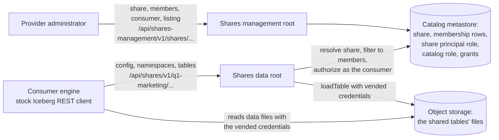
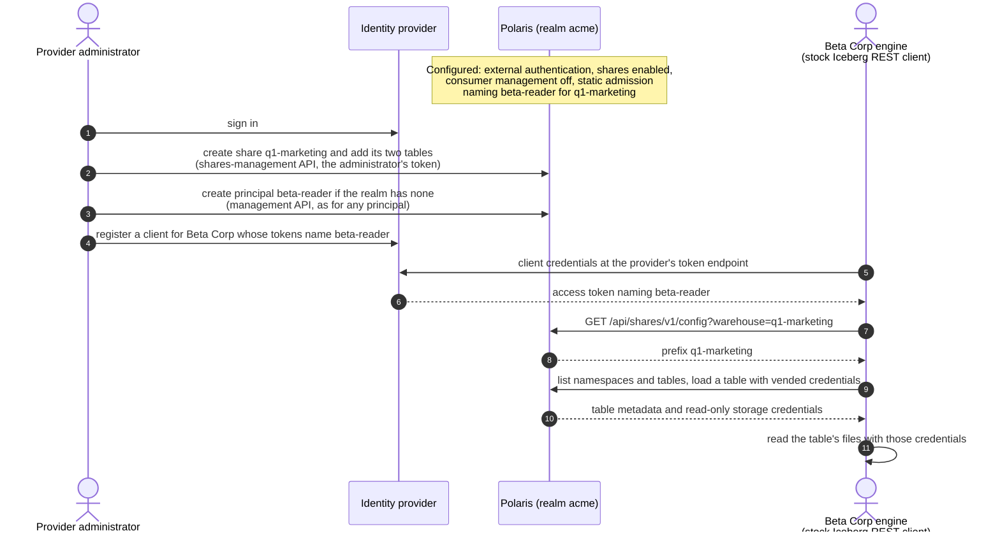

<!-- promoted: receipt pr-cddc98d4 · public-id shares-journeys · class state · revision 2 · supersedes receipt pr-96c605dc · exported 2026-10-23 · license Apache-2.0 · body-sha256 5f4aa8ecc3e0e898d9c91577860f8b265d4cdcd2b7112233bcdbfc3bafc316d7
     source: a private provenance chain (opaque; the mapping lives with the source). This document is maintained
     in place: every revision is a commit; earlier revisions stay in history, which is never rewritten. -->

# Polaris shares: end-to-end journeys under each combination of design choices

Companion to the Polaris shares design document, whose public revision follows its check against the implementation. The design holds the decisions and their reasons. This note shows what they look like: for each combination of the choices that change URLs, every provider and consumer call, with paths and example payloads. Payloads that do not vary are defined once, under "Payload shapes".

Revised 2026-10-23 for the specification in apache/polaris#5446 as of that date (`info.version` 0.0.1). It takes J1's choices: its own management root `/api/shares-management/v1`, and top-level shares each bound to one catalog. The data root and the prefix keying are outside the specification and come with the implementation. J4 to J6 stay as the record of the alternatives not taken. Through 0.0.6, J1 to J4 used the management API's root, `/api/management/v1`; the paths below use the current root.

The specification now has two files. Shares and members are the core API. External consumers, credentials, listings and endpoint configuration are the optional consumer-management API. J1 to J6 use both. Two sections then show J1 without consumer management, and J1 on a realm whose tokens all come from an external identity provider. The last two journeys, J7 and J8, follow alternatives raised in review: the authorizer deciding who reads a share, and shares with no consumers or listings at all.

## The choices that change paths

| Axis | Option | Effect on paths |
|---|---|---|
| Control-plane root | (i) `/api/shares/v1` · (ii) `/api/management/v1` (through 0.0.6) · (iv) `/api/shares-management/v1` (current) | where every provider call starts |
| Share addressing | (a) top-level `/shares/{share}` (bound to one catalog by rule in v1) · (b) nested `/catalogs/{catalog}/shares/{share}` | the provider's share paths and whether the body carries `catalogName` |
| Data root | (a) shared: `/api/catalog` with a reserved prefix `system$share$<share>` · (b) distinct: `/api/shares` (or `/api/shares/v1/data` when the control-plane root is (i)) | the consumer's base URL, `warehouse` and `prefix` |
| Prefix keying | by share · by listing | the `warehouse` and `prefix` values the consumer uses |

Choices that do not change any path: how the share is stored, client credentials in v1, the owner, aliasing (deferred), and the create-path scaffolding, membership storage and binding step.

## The journeys compared

J1 is the recommended combination, and the specification takes its control-plane choices. Each journey after it differs from a neighbor in exactly one axis: J2, J3 and J4 each change one choice of J1 (the data root, the prefix keying, the share addressing); J5 changes J4's control-plane root; J6 changes J5's data root.

| Journey | Control-plane root | Share addressing | Data root | Prefix keying |
|---|---|---|---|---|
| J1 | (iv) `/api/shares-management/v1` | (a) top-level | (b) `/api/shares` | share |
| J2 | (iv) `/api/shares-management/v1` | (a) top-level | (a) `/api/catalog` + reserved prefix | share |
| J3 | (iv) `/api/shares-management/v1` | (a) top-level | (b) `/api/shares` | listing |
| J4 | (iv) `/api/shares-management/v1` | (b) nested | (b) `/api/shares` | share |
| J5 | (i) `/api/shares/v1` | (b) nested | (b) `/api/shares/v1/data` | share |
| J6 | (i) `/api/shares/v1` | (b) nested | (a) `/api/catalog` + reserved prefix | share |

Running example throughout: provider catalog `sales`, share `q1-marketing` with tables `marketing.campaigns` and `marketing.spend_by_region`, consumer `beta-corp`, listing `beta-corp-q1`, realm `acme`, host `polaris.example.com`.

## The two surfaces at a glance (J1)

The provider never touches the data root and the consumer never touches the management root; both roots read the same metastore, and the consumer's storage access is the ordinary vended credential, scoped to the shared tables.

## Payload shapes (invariant across journeys unless noted)

- CreateShare: `{ "share": { "name": "q1-marketing", "catalogName": "sales", "description": "FY26 Q1 marketing aggregates" } }` (under nested addressing `catalogName` must match the path).
- UpdateShareMembers: `{ "currentEntityVersion": 1, "updates": [ { "action": "ADD", "member": { "type": "TABLE", "canonical": { "namespace": ["marketing"], "name": "campaigns" } } }, { "action": "ADD", "member": { "type": "TABLE", "canonical": { "namespace": ["marketing"], "name": "spend_by_region" } } } ] }`; response `200` with the updated share and its new `entityVersion`. A member may appear at most once in a batch; a repeated member returns `400`.
- CreateExternalConsumer: `{ "externalConsumer": { "name": "beta-corp", "description": "Beta Corp analytics" } }`.
- CreateConsumerCredential: no request body; response `201 { "credentialId": "c1", "clientId": "…", "clientSecret": "…", "status": "ACTIVE", "oauth2ServerUri": <token endpoint>, "scope": "PRINCIPAL_ROLE:ALL" }` (the secret appears exactly once; rotation returns the same shape).
- CreateListing: `{ "name": "beta-corp-q1", "consumerName": "beta-corp" }`.
- EndpointConfig response: `{ "catalogEndpoint": <data root>, "warehouse": <warehouse>, "additionalHeaders": { "Polaris-Realm": "acme" } }`. With the credential's `<token endpoint>`, the three placeholders are the only journey-dependent values.
- Token request (every journey): `POST {oauth2ServerUri from the credential}` with `grant_type=client_credentials&client_id=…&client_secret=…&scope=PRINCIPAL_ROLE:ALL` and header `Polaris-Realm: acme`; response `{ "access_token": "…", "token_type": "bearer", "expires_in": 3600 }`. The token endpoint is the deployment's (an external identity provider when configured); with Polaris's in-server authentication it is mounted on the same root as the data plane: `https://polaris.example.com/api/shares/v1/oauth/tokens` under the distinct root, `https://polaris.example.com/api/catalog/v1/oauth/tokens` under the shared root. The in-server endpoint is deprecated upstream (deprecated for mandating it, not for a provider issuing its own tokens) and is shown as the default.
- ConfigResponse: `{ "overrides": { "prefix": <prefix> }, "defaults": {}, "endpoints": [ "GET /v1/{prefix}/namespaces", "GET /v1/{prefix}/namespaces/{namespace}", "GET /v1/{prefix}/namespaces/{namespace}/tables", "GET /v1/{prefix}/namespaces/{namespace}/tables/{table}", "GET /v1/{prefix}/namespaces/{namespace}/tables/{table}/credentials", "POST /v1/{prefix}/namespaces/{namespace}/tables/{table}/metrics" ] }`.
- LoadTableResult (every journey): `{ "metadata-location": "s3://acme-marketing/campaigns/metadata/00012.metadata.json", "metadata": { … }, "storage-credentials": [ { "prefix": "s3://acme-marketing/campaigns/", "config": { … short-lived, read-only … } } ] }` when the request carries `X-Iceberg-Access-Delegation: vended-credentials`.

## J1: shares-management root, top-level shares, distinct data root, keyed by share

Choices: control-plane root (iv) `/api/shares-management/v1` · share addressing (a) top-level · data root (b) `/api/shares` · prefix keyed by share.

| Step | Call | Payload / result |
|---|---|---|
| P1 Enable | deployment configuration `ENABLE_SHARES=true` | no API |
| P2 Create share | `POST /api/shares-management/v1/shares` | CreateShare (`catalogName` binds the one catalog; the share principal role and the catalog role in `sales` are created here) |
| P3 Add members | `POST /api/shares-management/v1/shares/q1-marketing/members` | UpdateShareMembers; returns the updated share (a member outside `sales`, or named twice in the batch, returns `400`) |
| P4 Create consumer | `POST /api/shares-management/v1/external-consumers` | CreateExternalConsumer |
| P5 Mint credential | `POST /api/shares-management/v1/external-consumers/beta-corp/credentials` | CreateConsumerCredential with `oauth2ServerUri = https://polaris.example.com/api/shares/v1/oauth/tokens` |
| P6 Create listing | `POST /api/shares-management/v1/shares/q1-marketing/listings` | CreateListing (grants the consumer usage of the share principal role) |
| P7 Read endpoint config | `GET /api/shares-management/v1/shares/q1-marketing/listings/beta-corp-q1/endpoint-config` | EndpointConfig with `catalogEndpoint = https://polaris.example.com/api/shares`, `warehouse = q1-marketing` |
| C1 Token | `POST https://polaris.example.com/api/shares/v1/oauth/tokens` | Token request |
| C1a Discover (optional) | `GET /api/shares/polaris/v1/catalogs` | `{ "catalogs": [ { "name": "q1-marketing" } ] }`: one entry per listing; tools use it, stock clients skip it |
| C2 Config | `GET /api/shares/v1/config?warehouse=q1-marketing` | ConfigResponse with `prefix = q1-marketing` |
| C3 List namespaces | `GET /api/shares/v1/q1-marketing/namespaces` | `{ "namespaces": [["marketing"]] }` |
| C4 List tables | `GET /api/shares/v1/q1-marketing/namespaces/marketing/tables` | `{ "identifiers": [ {"namespace":["marketing"],"name":"campaigns"}, {"namespace":["marketing"],"name":"spend_by_region"} ] }` (members only) |
| C5 Load table | `GET /api/shares/v1/q1-marketing/namespaces/marketing/tables/campaigns` + delegation header | LoadTableResult |
| C6 Refresh credentials | `GET /api/shares/v1/q1-marketing/namespaces/marketing/tables/campaigns/credentials` | `{ "storage-credentials": [ … ] }` |
| C7 Write attempt | `POST /api/shares/v1/q1-marketing/namespaces/marketing/tables` | `404` (route not mounted) |
| C8 Non-member | `GET /api/shares/v1/q1-marketing/namespaces/marketing/tables/internal_costs` | `404 NoSuchTableException` |
| L1 Remove member | `POST /api/shares-management/v1/shares/q1-marketing/members` with `{"action":"REMOVE",…}` | member gone from every consumer's view |
| L2 Delete listing | `DELETE /api/shares-management/v1/shares/q1-marketing/listings/beta-corp-q1` | `204`; Beta Corp's next call fails |
| L3 Rotate credential | `POST /api/shares-management/v1/external-consumers/beta-corp/credentials/c1/rotate` | new pair; old valid for the service-defined overlap |
| L4 Delete consumer | `DELETE /api/shares-management/v1/external-consumers/beta-corp` | `204`; listings and credentials gone |
| L5 Delete share | `DELETE /api/shares-management/v1/shares/q1-marketing` | `204`; every listing revoked; the catalog role and principal role are dropped with it |

The roots read as siblings: `/api/shares-management/v1/…` beside `/api/management/v1/…` for the provider's administration, and `/api/shares/v1/…` beside `/api/catalog/v1/…` for the consumer.

## J2: shares-management root, top-level shares, shared data root, keyed by share

Choices: control-plane root (iv) `/api/shares-management/v1` · share addressing (a) top-level · data root (a) `/api/catalog` with the reserved prefix · prefix keyed by share.

Provider rows P1 to P4, P6 and lifecycle rows L1 to L5 are identical to J1. What changes:

| Step | Call | Payload / result |
|---|---|---|
| P5 Mint credential | as J1 | CreateConsumerCredential with `oauth2ServerUri = https://polaris.example.com/api/catalog/v1/oauth/tokens` |
| P7 Read endpoint config | as J1 | EndpointConfig with `catalogEndpoint = https://polaris.example.com/api/catalog`, `warehouse = system$share$q1-marketing` |
| C1 Token | `POST https://polaris.example.com/api/catalog/v1/oauth/tokens` | Token request (the shared root has no token endpoint of its own) |
| C2 Config | `GET /api/catalog/v1/config?warehouse=system$share$q1-marketing` | ConfigResponse with `prefix = system$share$q1-marketing`, `defaults = {}` (catalog properties scrubbed) |
| C3 List namespaces | `GET /api/catalog/v1/system$share$q1-marketing/namespaces` | as J1 |
| C4 List tables | `GET /api/catalog/v1/system$share$q1-marketing/namespaces/marketing/tables` | as J1 (filtered to members) |
| C5 Load table | `GET /api/catalog/v1/system$share$q1-marketing/namespaces/marketing/tables/campaigns` + delegation header | LoadTableResult |
| C6 Refresh credentials | `GET /api/catalog/v1/system$share$q1-marketing/…/tables/campaigns/credentials` | as J1 |
| C7 Write attempt | `POST /api/catalog/v1/system$share$q1-marketing/namespaces/marketing/tables` | refused by the share request filter before any handler (`404`, read-only surface) |
| C8 Non-member | `GET /api/catalog/v1/system$share$q1-marketing/namespaces/marketing/tables/internal_costs` | `404`, forbidden masked as not found |

What the consumer sees that J1 hides: the reserved internal name `system$share$q1-marketing` in every URL.

## J3: shares-management root, top-level shares, distinct data root, keyed by listing

Choices: control-plane root (iv) `/api/shares-management/v1` · share addressing (a) top-level · data root (b) `/api/shares` · prefix keyed by listing.

Provider rows are identical to J1. What changes:

| Step | Call | Payload / result |
|---|---|---|
| P7 Read endpoint config | as J1 | EndpointConfig with `warehouse = beta-corp-q1` (the listing) |
| C2 Config | `GET /api/shares/v1/config?warehouse=beta-corp-q1` | ConfigResponse with `prefix = beta-corp-q1` |
| C3 to C8 | `/api/shares/v1/beta-corp-q1/namespaces/…` | as J1, under the listing's prefix |
| L2 Delete listing | as J1 | Beta Corp's URLs stop working; other consumers' prefixes on the same share are untouched |

A second consumer on the same share gets its own prefix (`/api/shares/v1/gamma-inc-q1/…`); under J1 both consumers use `/api/shares/v1/q1-marketing/…` and are told apart by identity.

## J4: shares-management root, catalog-nested shares, distinct data root, keyed by share

Choices: control-plane root (iv) `/api/shares-management/v1` · share addressing (b) nested · data root (b) `/api/shares` · prefix keyed by share. Not taken by specification 0.0.6, kept as the record of the alternative.

Consumer rows are identical to J1. What changes on the provider side:

| Step | Call |
|---|---|
| P2 Create share | `POST /api/shares-management/v1/catalogs/sales/shares` |
| P3 Add members | `POST /api/shares-management/v1/catalogs/sales/shares/q1-marketing/members` |
| P6 Create listing | `POST /api/shares-management/v1/catalogs/sales/shares/q1-marketing/listings` |
| P7 Read endpoint config | `GET /api/shares-management/v1/catalogs/sales/shares/q1-marketing/listings/beta-corp-q1/endpoint-config` |
| L1, L2, L5 | the same paths with `/catalogs/sales/` before `/shares` |

This is the shape of the existing management API's nesting (`/catalogs/{catalog}/catalog-roles`), and it is the one that hard-codes the one-catalog rule into every path.

## J5: shares root, catalog-nested shares, distinct data root, keyed by share

Choices: control-plane root (i) `/api/shares/v1` · share addressing (b) nested · data root (b) `/api/shares/v1/data` · prefix keyed by share. Not taken by specification 0.0.6, kept as the record of the alternative.

| Step | Call | Payload / result |
|---|---|---|
| P1 Enable | deployment configuration `ENABLE_SHARES=true` | no API |
| P2 Create share | `POST /api/shares/v1/catalogs/sales/shares` | CreateShare |
| P3 Add members | `POST /api/shares/v1/catalogs/sales/shares/q1-marketing/members` | UpdateShareMembers |
| P4 Create consumer | `POST /api/shares/v1/external-consumers` | CreateExternalConsumer |
| P5 Mint credential | `POST /api/shares/v1/external-consumers/beta-corp/credentials` | CreateConsumerCredential |
| P6 Create listing | `POST /api/shares/v1/catalogs/sales/shares/q1-marketing/listings` | CreateListing |
| P7 Read endpoint config | `GET /api/shares/v1/catalogs/sales/shares/q1-marketing/listings/beta-corp-q1/endpoint-config` | EndpointConfig with `catalogEndpoint = https://polaris.example.com/api/shares/v1/data`, `warehouse = q1-marketing` |
| C1 Token | `POST https://polaris.example.com/api/shares/v1/oauth/tokens` | Token request |
| C2 Config | `GET /api/shares/v1/data/v1/config?warehouse=q1-marketing` | ConfigResponse with `prefix = q1-marketing` |
| C3 List namespaces | `GET /api/shares/v1/data/v1/q1-marketing/namespaces` | `{ "namespaces": [["marketing"]] }` |
| C4 List tables | `GET /api/shares/v1/data/v1/q1-marketing/namespaces/marketing/tables` | members only |
| C5 Load table | `GET /api/shares/v1/data/v1/q1-marketing/namespaces/marketing/tables/campaigns` + delegation header | LoadTableResult |
| C6 Refresh credentials | `GET /api/shares/v1/data/v1/q1-marketing/namespaces/marketing/tables/campaigns/credentials` | `{ "storage-credentials": [ … ] }` |
| C7 Write attempt | `POST /api/shares/v1/data/v1/q1-marketing/namespaces/marketing/tables` | `404` (route not mounted) |
| C8 Non-member | `GET …/namespaces/marketing/tables/internal_costs` | `404 NoSuchTableException` |
| L1 Remove member | `POST …/shares/q1-marketing/members` with `{"action":"REMOVE",…}` | member gone from every consumer's view |
| L2 Delete listing | `DELETE /api/shares/v1/catalogs/sales/shares/q1-marketing/listings/beta-corp-q1` | `204`; Beta Corp's next call fails |
| L3 Rotate credential | `POST /api/shares/v1/external-consumers/beta-corp/credentials/c1/rotate` | new pair; old valid for the service-defined overlap |
| L4 Delete consumer | `DELETE /api/shares/v1/external-consumers/beta-corp` | `204`; listings and credentials gone |
| L5 Delete share | `DELETE /api/shares/v1/catalogs/sales/shares/q1-marketing` | `204`; every listing revoked |

The consumer's base URL carries the version token twice, once for the shares API and once for the Iceberg protocol, because the management API owns `/api/shares/v1` in this combination.

## J6: shares root, catalog-nested shares, shared data root, keyed by share

Choices: control-plane root (i) `/api/shares/v1` · share addressing (b) nested · data root (a) `/api/catalog` with the reserved prefix · prefix keyed by share. Not taken by specification 0.0.6, kept as the record of the alternative.

Provider rows P1 to P6 and lifecycle rows L1 to L5 are identical to J5. The consumer rows are those of J2: `catalogEndpoint = https://polaris.example.com/api/catalog`, `warehouse = system$share$q1-marketing`, every consumer URL under `/api/catalog/v1/system$share$q1-marketing/…`, writes refused by the filter, forbidden masked as not found, and the reserved internal name visible in every consumer URL.

## Reading the six side by side

| | J1 | J2 | J3 | J4 | J5 | J6 |
|---|---|---|---|---|---|---|
| Provider root | `/api/shares-management/v1` | `/api/shares-management/v1` | `/api/shares-management/v1` | `/api/shares-management/v1` | `/api/shares/v1` | `/api/shares/v1` |
| Share path | `/shares/q1-marketing` | same | same | `/catalogs/sales/shares/q1-marketing` | same | same |
| Consumer base URL | `/api/shares` | `/api/catalog` | `/api/shares` | `/api/shares` | `/api/shares/v1/data` | `/api/catalog` |
| `warehouse` and `prefix` | `q1-marketing` | `system$share$q1-marketing` | `beta-corp-q1` | `q1-marketing` | `q1-marketing` | `system$share$q1-marketing` |
| Consumer table URL | `/api/shares/v1/q1-marketing/namespaces/marketing/tables/campaigns` | `/api/catalog/v1/system$share$q1-marketing/namespaces/marketing/tables/campaigns` | `/api/shares/v1/beta-corp-q1/namespaces/marketing/tables/campaigns` | as J1 | `/api/shares/v1/data/v1/q1-marketing/namespaces/marketing/tables/campaigns` | as J2 |
| Write refused by | route table | request filter | route table | route table | route table | request filter |
| Internal name visible to the consumer | no | yes | no | no | no | yes |
| One-catalog rule lives in | validation | validation | validation | the URL | the URL | the URL |

## J1 without consumer management: static admission

Choices as J1, but the deployment does not serve the optional consumer-management API and admits readers from a static configuration. The reader is an ordinary Polaris principal, `beta-reader`, whom the provider's administrator creates and grants as usual. In this version static admission covers principals stored in Polaris, whether they authenticate with Polaris credentials or through the deployment's identity provider (next section). Principals that exist only in the identity provider need an admission the authorizer decides, which is follow-up work.

| Step | Call | Payload / result |
|---|---|---|
| P1 Enable | deployment configuration: `ENABLE_SHARES=true`, consumer management not served, admission from a static file | no API |
| P1a Admission rule | the file names, for realm `acme` and share `q1-marketing`, the principal `beta-reader` or a principal role it holds | no API; read at startup |
| P2 Create share | `POST /api/shares-management/v1/shares` | CreateShare, as J1 |
| P3 Add members | `POST /api/shares-management/v1/shares/q1-marketing/members` | UpdateShareMembers, as J1 |
| P4 to P7 | not served | the consumer-management routes answer as unserved routes; there is no external consumer, credential, listing or endpoint configuration |
| C1 Token | the principal's ordinary token: `POST https://polaris.example.com/api/catalog/v1/oauth/tokens` with its own client credentials | Token request |
| C2 to C8 | `/api/shares/v1/config?warehouse=q1-marketing`, then `/api/shares/v1/q1-marketing/...` | as J1: the same data root, prefix, member filtering and read-only vending |
| L1 Remove member | as J1 | member gone from every reader's view |
| L2 Revoke | remove the rule and restart, or revoke the matched principal role | the next request is refused with `404`; a role revocation takes effect at once |
| L5 Delete share | as J1 | `204`; no listings to revoke |

What the reader holds: nothing of the share's outside a share request. Each admitted request runs as a request-local principal with only the share's principal role, so `beta-reader`'s ordinary access on `/api/catalog` is exactly what its own grants allow. Audit events name `beta-reader` and the rule that admitted it.

## J1 with an external identity provider

Choices as J1, on a realm that authenticates only through the deployment's OpenID Connect provider (`polaris.authentication.type=external`). Every token comes from that provider. Polaris's own token endpoint answers `501` on such a realm, so no secret Polaris holds authenticates anyone. The reader is admitted by static admission, as in the previous section: in this version a listing's consumer authenticates only with a credential Polaris issues, so the consumer-management API is not served here.

Polaris maps each provider token to a principal it stores, as it does for every request on such a realm. A claim names the principal (`polaris.oidc.principal-mapper.name-claim-path`), and the token's role claims select among the principal roles that principal holds (`polaris.oidc.principal-roles-mapper`). This is the realm's default credential mode, `internal`.

| Step | Call | Payload / result |
|---|---|---|
| P1 Enable | deployment configuration: `polaris.authentication.type=external` with the provider's OIDC tenant, `ENABLE_SHARES=true`, `polaris.shares.consumer-management.enabled=false`, `polaris.shares.admission.type=static` | no API |
| P1a Admission rule | the static file names, for realm `acme` and share `q1-marketing`, the principal `beta-reader` or a principal role it holds: `{"realms": {"acme": {"shares": {"q1-marketing": {"principals": ["beta-reader"]}}}}}` | no API; read at startup |
| P1b Identity | at the identity provider: a client for Beta Corp whose tokens carry a claim naming `beta-reader` (for a role rule, also the role) | outside Polaris |
| P1c Principal | `POST /api/management/v1/principals` with `{ "principal": { "name": "beta-reader" } }`, unless the realm already has it; for a role rule, grant it the role as usual | `201`. Polaris returns a client secret with every principal it creates; on this realm that secret authenticates nothing |
| P2 Create share | `POST /api/shares-management/v1/shares` with the administrator's provider token | CreateShare, as J1 |
| P3 Add members | `POST /api/shares-management/v1/shares/q1-marketing/members` | UpdateShareMembers, as J1 |
| P4 to P7 | not served | no external consumer, credential, listing or endpoint configuration |
| C1 Token | the provider's token endpoint, with the client Beta Corp holds there | the provider's token response |
| C2 to C8 | as J1, with `Authorization: Bearer <provider token>` | as J1: the same data root, prefix, member filtering and read-only vending |
| L1 Remove member | as J1 | member gone from every reader's view |
| L2 Revoke | remove the rule and restart, revoke the matched principal role, or disable the client at the provider | the first two: the next request is refused with `404`. The third: no new token is issued, and tokens already issued last until they expire |
| L5 Delete share | as J1 | `204` |

Beta Corp's engine needs only the stock Iceberg REST catalog properties: `uri=https://polaris.example.com/api/shares`, `warehouse=q1-marketing`, `header.Polaris-Realm=acme`, and the provider's token endpoint and client as `oauth2-server-uri`, `credential` and `scope`. Nothing in them comes from Polaris but the URL and the share's name.

Which admission serves which identity setup, in this version:

| How the realm identifies a reader | Listings (J1 to J3) | Static admission |
|---|---|---|
| Polaris-issued credentials (`internal`) | yes | yes (previous section) |
| The provider's identity provider, principals stored in Polaris (credential mode `internal`, the default) | not on a realm that authenticates externally only: creating or rotating a consumer credential answers `409` before any secret exists. On a `mixed` realm the consumer still uses a Polaris-issued credential | yes (this section) |
| The identity provider alone, no principal stored (credential mode `external`) | no | no |

The two gaps are planned work in the design: binding an external consumer to an identity provider's issuer and subject, so a listing admits it with no Polaris-issued secret (the external identity provider addendum), and an admission the authorizer decides, which can admit principals Polaris does not store (J7 below).

## Alternatives raised in review: J7 and J8

Review of the specification asked two things: that the Shares API be neutral on authentication and authorization, and that every access decision go through Polaris's authorizer. J7 and J8 follow two answers through the running example. Neither is in the specification. J1 to J6 vary paths. J7 keeps them and changes who decides that a caller may read a share. J8 removes external consumers and listings from the API.

### J7: the authorizer decides who reads

| Axis | Option | Effect |
|---|---|---|
| Admission | (x) **listings**: the data root admits a request only through an active listing for the caller; an authorizer can deny inside that gate but never widen it (J1 to J6) · (y) **the authorizer decides**: the data root asks the realm's authorizer whether the caller may read the share, and membership still bounds what the share exposes (J7) | No path changes. It changes who can grant a read, how revocation propagates, and what a listing is |

The split in (y): **the authorizer decides who reads a share; the share decides what is in it.**

Choices: as J1, with admission (y). Rows not listed are J1's.

| Step | Call | Payload / result | What J7 changes |
|---|---|---|---|
| P4 Create consumer | `POST /api/shares-management/v1/external-consumers` | CreateExternalConsumer | A named recipient. How it authenticates is the deployment's choice |
| P5 Mint credential | `POST /api/shares-management/v1/external-consumers/beta-corp/credentials` | CreateConsumerCredential | Only where the deployment issues credentials. Under an identity provider the consumer is bound to an issuer and subject instead (not specified yet) |
| P6 Create listing | `POST /api/shares-management/v1/shares/q1-marketing/listings` | CreateListing | A grant record: "share `q1-marketing` is granted to `beta-corp`". Built-in RBAC compiles it into the same grant J1 writes. An external authorizer receives it as input |
| C1 Token | Polaris's token endpoint, or the identity provider's | Token request | none |
| C1a Discover (optional) | `GET /api/shares/polaris/v1/catalogs` | `{ "catalogs": [ { "name": "q1-marketing" } ] }` | The shares the authorizer lets the caller read, not one entry per listing |
| C2 to C8 | as J1 | as J1 | Each request: resolve the share, ask the authorizer "may this principal read `q1-marketing`?" with the share and the caller's listing (if any) as input, then serve within membership. A refusal is J1's masked `404` |
| L2 Delete listing | as J1 | `204` | Under built-in RBAC the grant is dropped and the next call fails, as in J1. Under an external authorizer the next call fails if its policy keys on the listing Polaris passes; a policy that ignores listings is the deployment's choice |

Admission under each realm setup, with the same paths:

| Realm setup | Caller identity at the data root | Who admits | Audit attributes the read to |
|---|---|---|---|
| Polaris credentials, built-in RBAC (J1's setup) | the consumer's principal | RBAC, through the grant the listing wrote; the same outcome as J1 | consumer, listing, share |
| Identity provider, principals stored in Polaris, built-in RBAC | a stored principal, or a consumer bound to the token's issuer and subject | as above | as above |
| Identity provider alone, no principal stored, external authorizer | a principal built from the token's claims | the authorizer's policy, with the share and any matching listing as input | principal, share, and the listing when one matches |

The third row is the setup J1 cannot serve: Polaris requires an external authorizer when principals are not stored, and J1's listing gate looks a consumer up by its stored entity.

| | J1 | J7 |
|---|---|---|
| Paths and payloads | | the same |
| Who decides that a principal may read a share | the listing; an authorizer can only deny | the authorizer, with listings as input |
| Can an authorizer widen *who* reads | no | yes: a policy can admit a principal with no listing |
| Can an authorizer widen *what* is read | no | no: membership still bounds the share |
| Principals that exist only in an identity provider | no path | admitted in that mode |
| A listing is | the binding and the gate | the standardized grant record |
| Discovery on the shares root lists | the caller's listings | the shares the authorizer admits the caller to |
| Deleting a listing revokes | at once | at once under RBAC; under an external authorizer, as its policy treats listing input |
| Specification change | none | the core text says the authorizer decides admission, using consumers and listings; "grants an external consumer access" becomes "records a grant" |
| Implementation change | none | a third admission implementation beside listings and static admission, which asks the authorizer. The Authorizer SPI gains a share-read operation: an interface change, for the dev list first |

Open questions for J7:

1. **May an authorizer admit a principal with no listing?** As drafted, yes. A stricter variant keeps an active listing as a precondition and lets the authorizer choose only among listed consumers, which leaves *who* reads as in J1.
2. **The share-read operation's name and privilege** on the Authorizer SPI.
3. **Does the identity-provider-only mode still need a consumer record,** or may a listing name a principal, or an issuer and subject, directly? The second keeps `ExternalConsumer` for the other two setups only.

### J8: shares with ordinary Polaris RBAC

The Shares API defines shares and their members, nothing more. Who reads a share is ordinary Polaris authorization: role assignments through the management API, role claims from an identity provider, or an external authorizer's policy. A partner is an ordinary principal.

| Step | Call | Result |
|---|---|---|
| P2 Create share | `POST /api/shares-management/v1/shares` | as J1: the share, its principal role, and its catalog role in `sales` |
| P3 Add members | `POST /api/shares-management/v1/shares/q1-marketing/members` | as J1 |
| P4′ Create the partner | `POST /api/management/v1/principals` `{ "principal": { "name": "beta-corp" } }` | an ordinary principal, returned with its client id and secret |
| P6′ Grant the share | `PUT /api/management/v1/principals/beta-corp/principal-roles` naming the share's principal role | a role assignment: the same grant a listing writes today |
| P7′ Hand over connection details | none | the administrator assembles the data root, `warehouse = q1-marketing`, the token endpoint and any headers by hand |
| C1 to C8 | as J1 | as J1, if the shares data root is kept |
| L2′ Revoke | `DELETE /api/management/v1/principals/beta-corp/principal-roles/{share role}` | the next call fails |
| L3′ Rotate | `POST /api/management/v1/principals/beta-corp/rotate` | a new pair, through the principal's own rotation |
| L4′ Remove the partner | `DELETE /api/management/v1/principals/beta-corp` | as J1 |

Under an identity provider whose principals Polaris does not store, P4′ and P6′ disappear: the partner's token carries the share's role as a claim, and the identity provider's administrator decides who gets it.

Following it through:

1. **The share's role reaches the whole catalog's names.** The share's catalog role holds `NAMESPACE_LIST`, `NAMESPACE_READ_PROPERTIES` and `TABLE_LIST` on the catalog, and read access on member tables only. Polaris grants it that way because the shares data root runs the catalog's own list and load operations and then filters their results to members. A principal holding the share's role ambiently, as P6′ grants it, can also call the catalog root, `/api/catalog/v1/sales/…`. There it can list every namespace and table name in `sales` and read every namespace's properties. Two fixes:
   - Keep the reader on the shares root. That needs something at request time that marks the caller as share-only: for a stored principal, a marker on it, which is what an external consumer's principal carries today; for a principal Polaris does not store, a marker on roles from token claims, which only the identity provider controls. Either way the consumer distinction returns below the API, where the specification cannot name it.
   - Narrow the share's grants to members and rely on general list filtering in the catalog API (an open upstream proposal). Then the shares root becomes optional, and a share is a catalog role with read grants.
2. **"Shared with whom" becomes a graph query.** It asks for the share role's assignees. An assignment has no state, no metadata of its own and no record for audit, and if an ordinary principal role holds several shares' catalog roles, the answer is several hops away.
3. **The connection hand-off is unspecified.** J1's endpoint configuration has no counterpart.
4. **External identity providers and authorizers fit without new objects.** That is J8's strength.
5. **Partners sit in the principals list** beside internal service principals, with the same rotate and reset operations.

The static-admission journey above is J8's shape without the first point's exposure. The reader is an ordinary principal and no consumer or listing exists. But the reader never holds the share's role: each admitted request runs with that role alone, so its own requests to the catalog root see only what its own grants allow.

Sharing products split along the same line. Within one organization's identity domain, sharing is a grant to an identity the provider already knows, as in J8. Open sharing to a party outside that domain needs an object for the recipient and a binding, as in J1. The design's industry comparison has the details.
